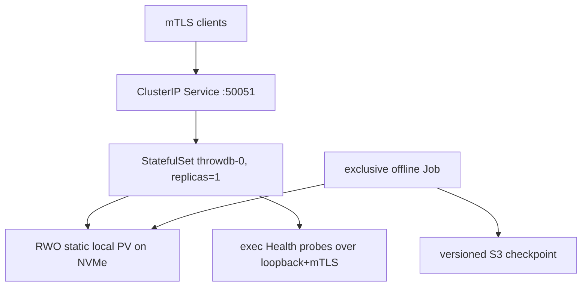

# Kubernetes deployment and operations

This runbook deploys one writable format-7 collection on one local NVMe. It
does not create replication or failover. Read the
[production-readiness review](repository-review.md) before using it.

Reviewed assets:

- `deploy/docker/Dockerfile` — non-root runtime image built from a Linux wheel;
- `deploy/kubernetes/base` — Kustomize base for one mTLS StatefulSet;
- `deploy/kubernetes/examples/local-storage.yaml` — static local NVMe example;
- `deploy/kubernetes/examples/*-job.yaml` — offline create, tune, backup, and
  restore examples;
- `deploy/kubernetes/healthcheck.py` — mTLS-capable exec probe.

## Deployment model



The non-negotiable rules are:

1. Keep `replicas: 1` for a writable service.
2. Never run an offline write/tune/backup Job while the writable pod owns the
   collection.
3. Never attach two independent copies of one logical collection to the same
   writable Service.
4. Do not manually remove lock, WAL, catalog, run, partition, or segment files.
5. Treat the node and local PV as one failure domain.

## Prerequisites

- Kubernetes with StatefulSet, Kustomize, exec probes, and a CNI implementing
  NetworkPolicy if the optional policy is used;
- an x86_64 Linux node with glibc 2.28+ compatible container runtime;
- a dedicated local NVMe filesystem with POSIX `rename`, `fsync`, advisory
  locks, open-file, and unlink semantics;
- a deployable CPython-matching `manylinux_2_28_x86_64` ThrowDB wheel;
- an immutable runtime OCI image built from that wheel;
- a server certificate, client CA, and dedicated probe-client certificate;
- for disaster recovery, an S3 bucket with Versioning `Enabled` and an ops
  image containing a current AWS CLI;
- monitoring capable of polling gRPC `Describe` and ingesting JSON logs.

CephFS, NFS, and object-backed filesystem mounts are outside the current
durability contract. Clients may be remote; the collection payload stays on
local NVMe.

## 1. Build and publish the image

Follow [`release-packaging.md`](release-packaging.md). The short path is:

```bash
mkdir -p wheelhouse
cp /secure/artifacts/throwdb-0.1.0-cp311-cp311-manylinux_2_28_x86_64.whl \
  wheelhouse/throwdb.whl

docker build \
  -f deploy/docker/Dockerfile \
  -t registry.example/throwdb:0.1.0 \
  .
docker push registry.example/throwdb:0.1.0
```

Record the resulting digest. The base manifest's `throwdb:0.1.0` is a
placeholder, not a published image.

## 2. Prepare the NVMe node and static PV

Choose a capacity with room for growth, WAL/runs, temporary selective-cleaner
output, delayed orphan reclamation, and operational reserve. For a 1.5 TiB
collection, 3 TiB is a safer initial allocation than a 1.5–2 TiB partition.

On the selected node:

```bash
sudo mkdir -p /mnt/nvme/throwdb-collection
sudo chown 10001:10001 /mnt/nvme/throwdb-collection
sudo chmod 0770 /mnt/nvme/throwdb-collection
```

Edit both placeholders in
`deploy/kubernetes/examples/local-storage.yaml`:

- `spec.local.path`;
- `REPLACE_WITH_NVME_NODE`.

Then create the cluster-scoped storage resources:

```bash
kubectl apply -f deploy/kubernetes/examples/local-storage.yaml
kubectl apply -f deploy/kubernetes/base/namespace.yaml
kubectl apply -f deploy/kubernetes/base/pvc.yaml
kubectl -n throwdb get pvc throwdb-data -o wide
```

The example uses `persistentVolumeReclaimPolicy: Retain` and
`kubernetes.io/no-provisioner`. Node affinity on the PV keeps every consumer on
the physical node that owns the directory. Static local PVC expansion is not
assumed. The declared local-PV capacity is scheduling metadata, not a filesystem
quota; monitor the actual filesystem and avoid unrelated consumers on it.

If the PVC remains Pending, inspect PV label selectors, storage class,
capacity, access mode, and node affinity. Do not replace it with network
storage merely to make scheduling succeed.

## 3. Create or restore the collection offline

Keep the StatefulSet absent or at zero replicas.

To build from NumPy files, edit:

- the runtime image;
- `REPLACE_WITH_SOURCE_PVC`;
- input filenames and output path;
- resources and active deadline.

Then:

```bash
CREATE_JOB=$(kubectl create \
  -f deploy/kubernetes/examples/create-job.yaml \
  -o name)
kubectl -n throwdb logs -f "$CREATE_JOB"
kubectl -n throwdb wait \
  --for=condition=complete \
  --timeout=25h \
  "$CREATE_JOB"
```

For a restore, follow the restore section below. Do not restore over an active
directory.

Run normal inspection and one full verification from a controlled offline Job
or a temporary pod mounting the same PVC:

```bash
throwdb inspect --storage /var/lib/throwdb/collection
throwdb inspect \
  --storage /var/lib/throwdb/collection \
  --verify-index
```

The second command reads every format-7 payload checksum. It belongs in build,
restore, and periodic audit workflows, not in every startup probe.

## 4. Calibrate on the final runtime

Do not calibrate in an init container on every restart. Profiles are persisted
inside the collection and reused.

Run the example tuning Job only after making its image, CPU, memory, seccomp,
PVC, node, and kernel equivalent to the final server pod:

```bash
TUNE_JOB=$(kubectl create \
  -f deploy/kubernetes/examples/tune-job.yaml \
  -o name)
kubectl -n throwdb logs -f "$TUNE_JOB"
kubectl -n throwdb wait \
  --for=condition=complete \
  --timeout=35m \
  "$TUNE_JOB"
```

Inspect `tune-report.json` and the registry:

```bash
throwdb tuning show --storage /var/lib/throwdb/collection
throwdbd \
  --storage /var/lib/throwdb/collection \
  --tuning persisted \
  --listen 127.0.0.1:0 \
  --dry-run
```

The checked-in StatefulSet starts with `--tuning auto` so a missing or
incompatible profile falls back conservatively. Change it to `persisted` after
the controlled calibration if fail-closed performance selection is preferred.
Changing CPU quota, kernel, container runtime, seccomp, physical disk, or
visible mount identity may require a new calibration.

If the winner uses `io_uring`, validate it in the actual pod security context.
Some runtimes block io_uring syscalls. Prefer a verified thread-pool profile or
a narrowly scoped custom seccomp policy over `privileged`.

## 5. Issue mTLS certificates and Secrets

The server certificate should include these DNS SANs when the reviewed names
are retained:

```text
throwdb.throwdb.svc
throwdb.throwdb.svc.cluster.local
```

The probe connects to loopback but overrides TLS authority to the Service DNS
name; no loopback IP SAN is required by the provided probe. Use a dedicated
probe-client certificate signed by the same client CA that the server trusts.
Do not reuse the server private key as a client key.

Create Secrets without committing private material:

```bash
kubectl -n throwdb create secret generic throwdb-server-tls \
  --from-file=tls.crt=server.crt \
  --from-file=tls.key=server.key \
  --from-file=ca.crt=clients-ca.crt

kubectl -n throwdb create secret generic throwdb-probe-client-tls \
  --from-file=ca.crt=server-ca.crt \
  --from-file=tls.crt=probe-client.crt \
  --from-file=tls.key=probe-client.key
```

The native daemon reads certificates only at startup. Updating a Secret needs
a controlled pod restart.

Kubernetes' built-in gRPC probe cannot present a client certificate. The
reviewed manifest therefore uses an exec probe backed by
`deploy/kubernetes/healthcheck.py`. Startup/readiness require `SERVING`;
liveness accepts a valid `SERVING` or transient `NOT_SERVING` response. A
terminal storage fault makes the daemon exit nonzero, so Kubernetes still
restarts it.

If the namespace, Service, or cluster domain changes, update both certificate
SANs and every `--server-name` value in the StatefulSet probes.

## 6. Set image and resources

Create an environment overlay rather than editing the base in place:

```bash
mkdir -p /tmp/throwdb-prod-overlay
cp deploy/kubernetes/base/kustomization.yaml \
  /tmp/throwdb-prod-overlay/kustomization.yaml
```

In a real GitOps repository, reference the base and use `images`, patches, and
policy validation. At minimum, set the immutable image:

```yaml
images:
  - name: throwdb
    newName: registry.example/throwdb
    newTag: 0.1.0
    digest: sha256:REPLACE_WITH_DIGEST
```

With an older Kustomize implementation that lacks `digest`, patch the
StatefulSet image to the complete `name:tag@sha256:...` string and verify the
rendered output.

The example requests and limits 16 CPU and 64 GiB, producing Guaranteed QoS.
These are starting values, not universal sizing. Measure:

- peak RSS after opening the production index;
- overlay growth at the configured entry cap;
- gRPC quota plus unary/scan admission pools;
- materialization peak memory (1 GiB default budget);
- cleaner peak memory (2 GiB default budget);
- filesystem page-cache pressure charged to the pod cgroup;
- CPU throttling under the real cgroup quota.

Set memory requests/limits above the measured total with failure margin. A
small guessed limit turns ordinary cache/maintenance pressure into OOMKill and
service downtime. On a dedicated node, a large Guaranteed allocation or an
explicitly accepted no-memory-limit policy is preferable to a misleading low
limit.

The manifest reserves 100 GiB of filesystem headroom for new mutations and
large maintenance output. Size this as at least the largest configured
maintenance output plus emergency headroom; 5–10% of the volume is a useful
starting operational threshold.

## 7. Deploy

Render and inspect first:

```bash
kubectl kustomize deploy/kubernetes/base > /tmp/throwdb-rendered.yaml
kubectl apply --dry-run=server -f /tmp/throwdb-rendered.yaml
```

Patch the image/resources and apply through the deployment system. For the
unmodified local example:

```bash
kubectl apply -k deploy/kubernetes/base
kubectl -n throwdb get pod -w
kubectl -n throwdb logs -f statefulset/throwdb
```

The daemon prints one JSON `ready` record only after the collection is open,
the socket is bound in NOT_SERVING state, the maintenance worker has started,
and Health has changed to SERVING.

Verify:

```bash
kubectl -n throwdb get pod throwdb-0
kubectl -n throwdb get endpointslice \
  -l kubernetes.io/service-name=throwdb
kubectl -n throwdb exec throwdb-0 -- \
  python /opt/throwdb/healthcheck.py \
    --endpoint 127.0.0.1:50051 \
    --root-ca /etc/throwdb/tls/probe/ca.crt \
    --client-cert /etc/throwdb/tls/probe/tls.crt \
    --client-key /etc/throwdb/tls/probe/tls.key \
    --server-name throwdb.throwdb.svc.cluster.local \
    --require-serving
```

Run sampled reads through a real client certificate before sending normal
traffic.

## 8. Client connection

```python
import grpc
import throwdb

credentials = grpc.ssl_channel_credentials(
    root_certificates=open("server-ca.crt", "rb").read(),
    private_key=open("client.key", "rb").read(),
    certificate_chain=open("client.crt", "rb").read(),
)

with throwdb.RemoteCollection.connect(
    "throwdb.throwdb.svc.cluster.local:50051",
    credentials=credentials,
    timeout=30,
) as collection:
    print(collection.health())
    print(collection.describe())
    vectors = collection.get([1, 2, 3])
```

Label authorized client pods and adapt the optional
`examples/network-policy.yaml`. mTLS currently authenticates membership in a
trusted client CA only; ThrowDB does not map certificate identities to roles or
differentiate readers from writers. Use a dedicated CA and network policy as
part of the trust boundary.

## 9. Shutdown and update

The StatefulSet uses `OnDelete` because a zero-downtime rolling update is not
possible with one writer/local PV.

On SIGTERM the daemon:

1. reports NOT_SERVING;
2. closes admission for new data RPCs;
3. drains gRPC for up to 30 seconds;
4. asks maintenance to stop between actions;
5. exits forcibly and nonzero at the 60-second hard process bound if native
   work cannot finish.

`terminationGracePeriodSeconds: 90` is intentionally longer than the hard
deadline. Do not add a preStop sleep that leaves the endpoint SERVING. The
daemon itself initiates drain immediately when kubelet sends SIGTERM.

Controlled update:

1. Complete and verify a backup.
2. Test the new wheel/image against a copy of the collection.
3. Confirm on-disk backward/rollback compatibility.
4. Patch the immutable image digest.
5. Delete `throwdb-0` explicitly.
6. Wait for the replacement pod to become Ready.
7. Verify ready JSON, Health, Describe, and sampled reads.

```bash
kubectl -n throwdb delete pod throwdb-0
kubectl -n throwdb rollout status statefulset/throwdb --timeout=15m
```

The PDB protects against voluntary eviction and may intentionally block a node
drain. It does not protect against node failure and cannot create a second
copy. Relax/remove it only as an explicit maintenance decision after a fresh
backup.

## 10. Backup operation

### Writable service

The checked-in S3 protocol cannot back up a live writable daemon. The daemon
holds the writer lease, and a consistent multi-file checkpoint requires a
quiesced source.

Use an external workflow with an unconditional cleanup/finally branch:

1. Block new application writes.
2. Scale the StatefulSet to zero.
3. Wait for pod deletion and writer-lease release.
4. Ensure no calibration, tuning-profile save/remove/reset, maintenance, or
   other offline operation can start.
5. Run `backup-job.yaml` from an ops image with current AWS CLI.
6. Record the backup ID, LATEST timestamp, duration, source generation, and
   result.
7. Scale the StatefulSet back to one even when backup fails.
8. Verify Health and sampled reads.

```bash
kubectl -n throwdb scale statefulset/throwdb --replicas=0
kubectl -n throwdb wait \
  --for=delete pod/throwdb-0 \
  --timeout=10m

# Edit image, S3 URI and cloud workload identity first. The generated Job
# name makes every attempt an independently retained publication record.
kubectl apply \
  -f deploy/kubernetes/examples/backup-service-account.yaml
BACKUP_JOB=$(kubectl create \
  -f deploy/kubernetes/examples/backup-job.yaml \
  -o name)
kubectl -n throwdb logs -f "$BACKUP_JOB"
kubectl -n throwdb wait \
  --for=condition=complete \
  --timeout=13h \
  "$BACKUP_JOB"

kubectl -n throwdb scale statefulset/throwdb --replicas=1
```

`backoffLimit: 0` is deliberate: the publication protocol does not blindly
retry an ambiguous conditional S3 commit. The example gives ThrowDB 41,400
seconds internally and Kubernetes 43,200 seconds, leaving 30 minutes for a
controlled failure report and process termination instead of killing the pod at
the protocol deadline.

Hashing 1.5 TiB while the service is down may create hours of outage. The
preferred next infrastructure step is a short quiesce plus LVM/ZFS/local-CSI
snapshot, followed by backup from a writable clone of that frozen snapshot.
The clone must permit ThrowDB to persist its local destination lineage cursor.

### Read-only service

A read-only daemon does not own the writer lease, but backup still requires the
source bytes to remain unchanged. A CronJob is acceptable only if no other
writer, calibration, tuning-registry mutation, or maintenance can run. Use
`concurrencyPolicy: Forbid`, `backoffLimit: 0`, a deadline, and backup-age
alerts. A mere schedule is not evidence that a checkpoint succeeded.

### Current tuning-metadata race

The reviewed backup serializes collection writes but not the independent
tuning-registry lock. A tuning-profile change during the long sync can publish
a completion whose recorded tuning-file checksum differs from the uploaded
version. Restore then fails closed. Until code-level serialization is added,
the backup window must be exclusive with respect to every tuning command and
profile-registry mutation.

## 11. Restore and failover to a new path

Restore is offline and never in place:

1. Fence/stop the old writable pod.
2. Provision a new sufficiently large local PV/PVC, preferably on the recovery
   node.
3. Edit the ops image, S3 URI, exact monitored backup ID, destination path, and
   claim in `restore-job.yaml`.
4. Run the restore Job.
5. Execute full native verification and sampled reads.
6. Tune on the recovery node/runtime.
7. Patch `THROWDB_COLLECTION_PATH` and the PVC reference.
8. Start one new pod and switch the Service only after readiness.
9. Never bring the old writable copy back into the same logical service.

```bash
kubectl apply \
  -f deploy/kubernetes/examples/backup-service-account.yaml
RESTORE_JOB=$(kubectl create \
  -f deploy/kubernetes/examples/restore-job.yaml \
  -o name)
kubectl -n throwdb logs -f "$RESTORE_JOB"
kubectl -n throwdb wait \
  --for=condition=complete \
  --timeout=13h \
  "$RESTORE_JOB"
```

Record actual RPO and RTO. RTO includes complete download, SHA-256 validation,
native validation, calibration if needed, pod open, and application checks.
The restore example uses the same 41,400-second internal/43,200-second pod
deadline split.

## 12. Monitoring and alerts

There is no Prometheus endpoint yet. Poll `RemoteCollection.describe()` through
mTLS and export these fields:

- Health/Ready and process restart count;
- active unary calls/scans and estimated bytes;
- admitted/rejected unary calls and scans;
- admission closed, draining, and terminal-faulted state;
- active/frozen/total WAL bytes and operations;
- overlay entries and estimated bytes;
- delta runs and segment bytes;
- idempotency journal bytes, operations, generation, and configured caps;
- filesystem available bytes and mutation reserve;
- maintenance active state.

Ingest stdout/stderr as structured logs. Important events:

- stdout `event=ready`;
- stderr `event=maintenance,status=ok`;
- `deferred_insufficient_storage`;
- `deferred_mutation_capacity`;
- `terminal_storage_fault`;
- nonzero container termination.

Minimum alerts:

- pod not Ready or repeated restart;
- any terminal storage fault;
- increasing admission rejection rate;
- WAL/overlay above 70%, warning at 85%, critical near hard cap;
- idempotency journal above checkpoint trigger or nearing hard cap;
- filesystem headroom below reserve plus largest maintenance output, or below
  15–20% of the volume;
- repeated budget-blocked/error maintenance events;
- backup age above 18 hours warning and 24 hours critical for a 24-hour RPO;
- S3 Versioning not Enabled;
- certificate expiry and overdue restore drill.

## 13. Failure runbook

### Process crash

Kubelet restarts the pod on the same node. Kernel advisory locks are released;
startup resolves the pending fence/WAL before readiness. Do not remove lock
files.

### Repeated startup failure

Scale to zero, preserve logs, and run offline normal/full inspect. If native
integrity fails, do not edit files manually; restore a verified checkpoint to
a new path/PV.

### Disk pressure

New mutations reject before PREPARE when reserve cannot be preserved.
Maintenance may defer while reads remain available. Increase/migrate storage
or run bounded maintenance only when enough output headroom exists. Never
delete old-looking collection files by hand.

### Node/NVMe loss

The pod remains Pending because local data cannot move. Fence the old service,
provision a new NVMe/PV, restore the recorded backup, verify, tune, and start a
new singleton. This is manual DR, not automatic failover.

### `RESOURCE_EXHAUSTED`

Reads may retry with bounded jittered backoff and smaller batches. For an
ambiguous mutation, reconnect and retry the exact same request with the same
operation ID; do not mint a new ID until the original outcome is definitive.

### Certificate rotation

Issue and mount new server/probe/client material, patch Secrets, then perform a
controlled singleton restart. There is no TLS hot reload.

## Accepted limitations of this manifest

- no HA, replication, leader election, or automated fencing;
- one writable pod and one collection;
- planned outage for upgrades and consistent backups;
- local PV cannot follow pod scheduling to another node;
- mTLS membership only, without application authorization;
- no native metrics endpoint;
- no Helm/operator automation;
- no live writable checkpoint;
- no automatic rollback of on-disk format changes.

These limitations are explicit so Kubernetes does not create a false
impression of availability that the storage architecture does not provide.
