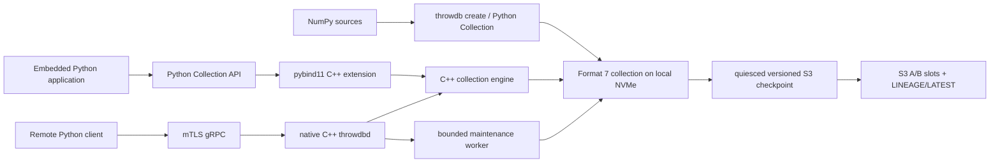

# Repository and production-readiness review

This document reviews the implementation at commit `3a37877`. It is an
engineering handoff, not a claim that ThrowDB is already a highly available
database. The current product is a strong single-node, single-collection
engine and service whose primary target is local NVMe.

## Executive assessment

The local format-7 engine, Python API, native gRPC service, mutation lifecycle,
bounded maintenance, tuning registry, and offline S3 recovery workflow are all
implemented and covered by a substantial automated test suite. The critical
data path is C++; the public Python daemon is a one-shot configuration launcher
that replaces itself with the native process before serving RPCs.

The design is suitable for a first controlled deployment when all of the
following are accepted:

- one writable process and one collection per service;
- one local NVMe volume tied to one Kubernetes node;
- planned downtime for upgrades and consistent backups;
- RPO determined by the last verified S3 checkpoint and RTO dominated by
  downloading and validating the complete collection;
- numeric `uint64` IDs only, with `float16` or `float32` vectors of one fixed
  dimension per collection;
- mTLS and network isolation as the security boundary, without application
  users, roles, or per-method authorization.

It is not yet an HA database, a multi-collection service, or a drop-in managed
database. Those are later product stages.

## Architecture



### Main components

| Component | Location | Responsibility |
|---|---|---|
| C++ core | `src/core`, `include/throwdb` | formats, reads, WAL, partition index, segment lifecycle, checksums, locks |
| Python local API | `python/throwdb/collection.py` | ergonomic create/open/CRUD/read/scan/tune/maintenance API |
| Python binding | `bindings/python_module.cpp` | NumPy-to-native boundary and native result exposure |
| gRPC contract | `proto/throwdb/v1/throwdb.proto` | Health, Describe, Get, CRUD, physical-order ScanIds |
| Native service | `src/server` | admission, idempotency, maintenance, mTLS, readiness and shutdown |
| Public launcher | `python/throwdb/server.py` | tuning selection and `execve` into packaged native daemon |
| S3 recovery | `python/throwdb/s3_backup.py` | versioned, checksummed, lineage-aware offline checkpoint/restore |
| Benchmarks | `benchmarks` | local load, tuning, remote benchmark, long-running remote soak |

## Implemented feature inventory

### Collection construction and schema

- Default creation format is format 7; format 6 remains a compatibility
  option.
- Embeddings are fixed-width row-major `float16` or `float32`.
- One dimension and dtype are fixed for the lifetime of a collection.
- Python accepts every standard NumPy signed/unsigned integer width when every
  value is non-negative and exactly representable as `uint64`.
- Build input is streamed in batches from `.npy`/memmap-compatible arrays.
- Duplicate build IDs are rejected.
- Publication is atomic: the manifest becomes visible only after all immutable
  resources and the index have been written.

### Reads

- Ordered point lookup by arbitrary numeric ID.
- Caller-owned `get_into()` output to avoid an additional native allocation.
- MRL-style prefix reads through `prefix_dimensions`.
- Sequential `pread`, shared fair thread-pool, and experimental Linux
  `io_uring` backends.
- Lookup planning sorts physical rows and coalesces ranges under configured
  byte/gap bounds.
- Mixed requests share DRR scheduling and bounded backend credits.
- `scan_ids()` streams IDs in physical `(segment_id, row_index)` order.
- Optional exact physical locations are returned with scans.
- `list_ids()` deliberately materializes the complete result without a memory
  guard; callers responsible for large collections should use `scan_ids()`.

Prefix reads are logically correct but the current dense-row physical layout
still reads a complete row before returning its prefix.

### Mutations and lifecycle

- WAL-backed `insert`, `update`, `upsert`, and tombstone `delete`.
- One writer lease per collection.
- Pending-mutation fence prevents maintenance from acting while an ambiguous
  PREPARE must be recovered.
- Hard startup and mutation bounds for retained WAL bytes/operations, overlay
  entries, and estimated overlay RAM.
- WAL rotation and bounded frozen-prefix materialization.
- Format-7 partition-selective index folding without rewriting all payloads.
- Selective cleaning of one qualifying high-garbage segment per action.
- Locked, age- and budget-bounded orphan collection.
- Explicit `maintain()` for embedded/CLI users and a bounded background worker
  for writable `throwdbd`.
- Disk reserve checks before new mutation and large maintenance output.

### Tuning

- Explicit bounded calibration; opening a collection never runs a benchmark.
- Candidate correctness is bit-exact.
- Throughput, tail latency, fairness, CPU/cgroup pressure, cache preparation,
  and physical-read evidence participate in selection guardrails.
- Profiles are stored inside the collection and keyed by storage/runtime/layout
  identity.
- `auto`, fail-closed `persisted`, conservative fallback, and explicit manual
  reader settings are available.
- Local disks and visible network filesystems get distinct identities; opaque
  container mounts can reuse a compatible performance-class profile.

### Single-collection server

- Synchronous native C++ gRPC server; Python is not in the request path.
- Read-only default; CRUD requires `--writable`.
- Typed and standard gRPC Health services.
- Deferred readiness until collection open and maintenance-thread startup have
  completed.
- mTLS required on non-loopback endpoints unless the explicit unsafe override
  is supplied.
- Separate bounded admission pools for unary calls and ID scans.
- Request/response size, decoded ID count, gRPC parser memory, scan duration,
  scan idle time, WAL, overlay, journal, and filesystem headroom limits.
- Cooperative native scan cancellation and server watchdog cancellation.
- Durable operation-ID idempotency with replay domains and checkpointed
  generations.
- Graceful drain followed by an absolute process shutdown watchdog.
- Terminal storage faults stop readiness, close admission, drain, and exit
  nonzero.
- `Describe` exposes effective tuning, limits, admission counters, WAL/overlay,
  journal, filesystem headroom, and maintenance activity.

### S3 disaster recovery

- Format-7-only, quiesced checkpoint.
- Bucket Versioning required; the sentinel VersionId `null` is rejected.
- Local writer lease and remote publisher lease.
- Alternating A/B payload slots.
- SHA-256 for every file and exact S3 VersionId/ETag inventory.
- Immutable lineage plus compare-and-swap `LATEST` publication.
- Stale-source and fork detection.
- Restore into a new path only, with pre/post remote-version checks, complete
  SHA-256 validation, native structural validation, fsync, and atomic publish.

This is disaster recovery, not online replication. The complete source is
hashed on every checkpoint and a changed S3 object is uploaded as a complete
object, not an in-file delta.

## Automated validation already present

The final hardening commit was validated with:

- `561/561` Python tests;
- `30/30` native/gRPC tests in the complete server build;
- `28/28` tests under ThreadSanitizer;
- `28/28` tests under AddressSanitizer/UndefinedBehaviorSanitizer;
- an isolated wheel smoke test covering create, reads, CRUD, maintenance, CLI,
  packaged launcher, and native gRPC daemon;
- byte-for-byte regeneration checks for committed Python protobuf outputs;
- production-binary inspection confirming test-only daemon hooks are absent.

The repository also includes deterministic benchmark and soak harnesses with
bit-exact verification, resource samples, restart/replay exercises, and
acceptance gates. These tools do not replace a real 1.5 TiB production soak.

## Review findings and risks

### P1: no usable Linux release artifact has been published yet

There is no tag, GitHub Release, PyPI package, private package-index entry, or
OCI image for the reviewed commit. The locally verified wheel is:

```text
/private/tmp/throwdb-wheel-final-20260717-2/
  throwdb-0.1.0-cp310-cp310-macosx_14_0_arm64.whl
SHA256 e7268329269c6beeacebca4972e6226f8cbb9e0d56969e7643e8b210239d9000
```

It is usable only with CPython 3.10 on macOS ARM64 and cannot be used in a
Linux Kubernetes pod. The configured Actions workflow can build
`manylinux_2_28_x86_64` wheels, but only a successful workflow artifact or a
new release channel constitutes a deployable Linux artifact. See
[`release-packaging.md`](release-packaging.md).

### P1: tuning metadata can race a long S3 checkpoint

The S3 checkpoint holds the collection writer lease, but tuning profile
publication uses a separate `tuning/reader-profiles.lock`. The checkpoint
builds its file inventory before a potentially long `aws s3 sync`; a concurrent
save/remove/reset of a tuning profile can therefore make the uploaded tuning
file differ from the completion's earlier SHA-256. Restore will fail closed on
the mismatch, so this does not silently restore corrupted embeddings, but it
can publish an unusable checkpoint and consume the RPO window.

Until the implementation also serializes tuning publication or repeats the
inventory before `LATEST`, production backup orchestration must prohibit every
`throwdb tune` and tuning-registry mutation for the complete checkpoint window.
The Kubernetes runbook enforces one exclusive offline operation at a time.

### P1: release/legal metadata is incomplete

- No project license has been selected and no LICENSE/third-party NOTICE is
  bundled, despite static native dependencies.
- Version `0.1.0` is duplicated in `pyproject.toml`, `CMakeLists.txt`, and the
  binding, with no tag/version consistency gate.
- The workflow uploads ephemeral Actions artifacts only; it does not publish a
  GitHub Release, package-index artifact, checksum manifest, SBOM, signature,
  provenance, or OCI image.
- The sdist requires an out-of-band native gRPC bootstrap and should not be
  presented as a normal fallback installation until that contract is solved.

License selection is a product-owner decision and is intentionally not guessed
by this review.

### P1: single-node availability and offline backup

- `replicas > 1` does not create HA and is invalid for a writable collection.
- A static local PV cannot move to another node after NVMe/node failure.
- A writable server must be stopped, or a quiesced writable snapshot clone must
  be used, for S3 backup.
- A 1.5 TiB checkpoint hashes the complete source; stopping the service for the
  entire operation can mean hours of downtime.
- Recovery downloads and verifies the complete collection before serving.

A storage-level snapshot mechanism is the most valuable next operational
improvement because it shortens the writable-service quiesce window without
weakening checkpoint consistency.

### P2: operations and security gaps

- No Prometheus exporter; operators must poll `Describe` and parse structured
  daemon logs.
- No application authentication/authorization, user identity, roles, per-RPC
  ACL, or application audit trail.
- TLS certificates are loaded at startup and require a controlled restart to
  rotate.
- No leader election, external fencing, read-replica refresh, or failover
  controller.
- No Helm chart/operator; reviewed raw Kustomize manifests are provided as the
  first deployment contract.
- No Linux ARM64, musl/Alpine, Windows, or official macOS release matrix.
- No packaged `doctor` command; the full wheel smoke tool remains in the source
  checkout.

## Production acceptance still required

Before the first real workload, record evidence for all of the following:

1. Build and retain a matching Linux wheel and immutable OCI image digest.
2. Run the complete quick/full read benchmark against the target local NVMe.
3. Run a multi-hour gRPC soak with the real request-size distribution.
4. Measure peak RSS at open and during materialization/cleaning under the final
   pod cgroup limits.
5. Confirm `io_uring` works under the selected container seccomp profile, or
   deliberately use a thread-pool profile.
6. Exercise SIGTERM, hard deadline, pod restart, writer-lock recovery, disk
   pressure, and admission saturation.
7. Run an actual versioned-S3 backup and restore to a different NVMe/PV.
8. Validate sampled application reads from the restored collection and record
   measured RPO/RTO.
9. Alert on backup age, readiness, restarts, disk headroom, admission rejects,
   WAL/overlay/journal thresholds, and maintenance errors.
10. Decide and document the project license and release retention policy.

## Documentation map

- [End-user guide](user-guide.md)
- [Kubernetes deployment and runbook](kubernetes-deployment.md)
- [Packaging and wheel release guide](release-packaging.md)
- [gRPC server contract](grpc-server.md)
- [Mutable format-7 lifecycle](mutable-storage.md)
- [Tuning profile contract](tuning-profiles.md)
- [Testing and benchmarks](testing.md)
